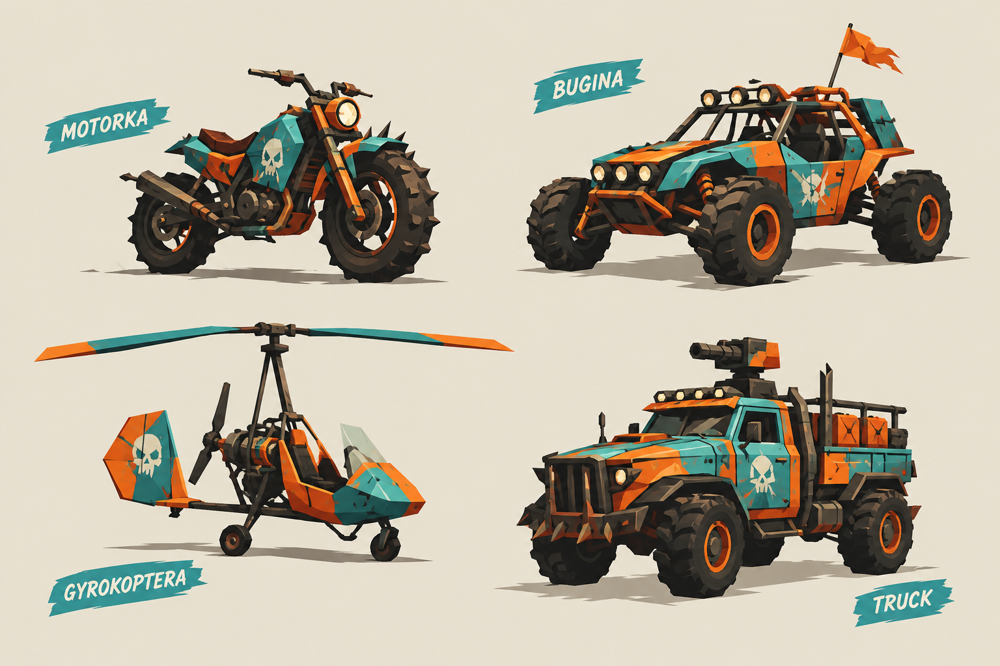
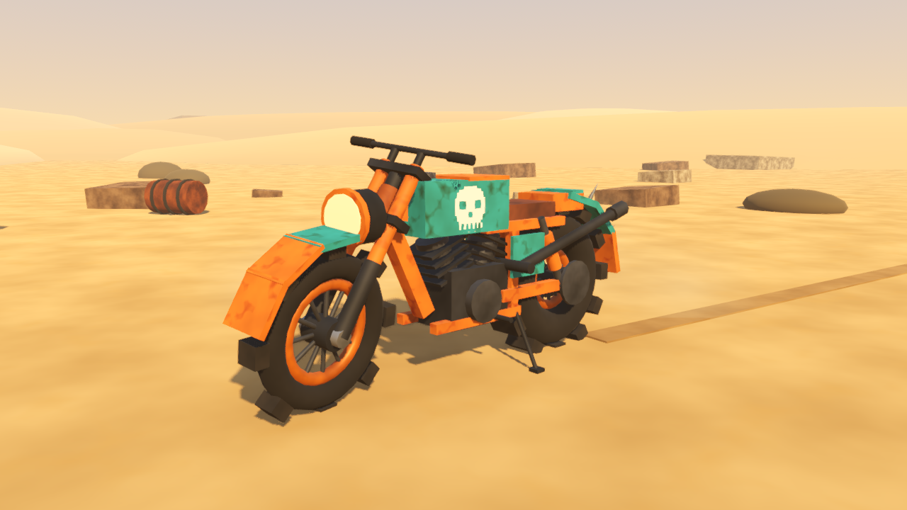
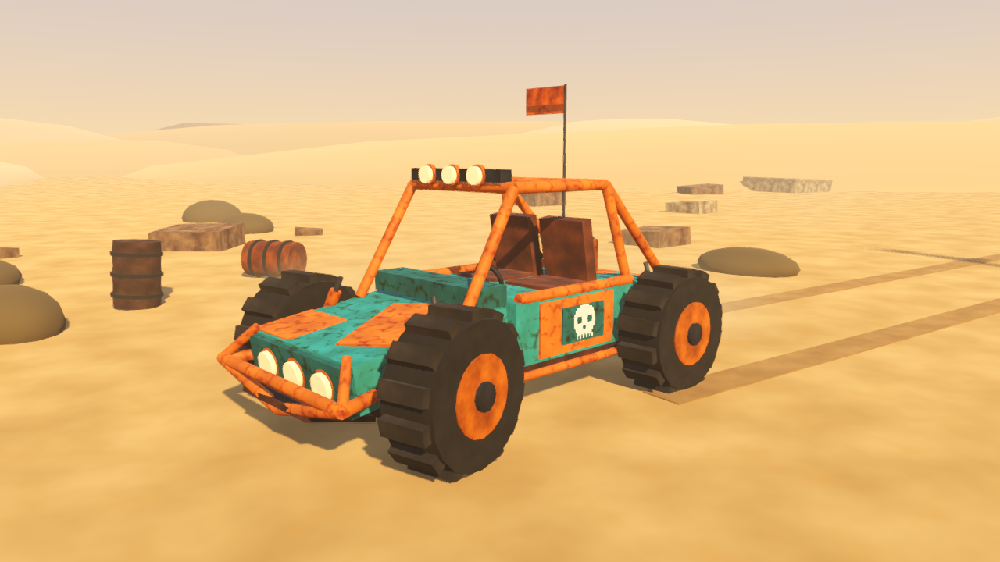
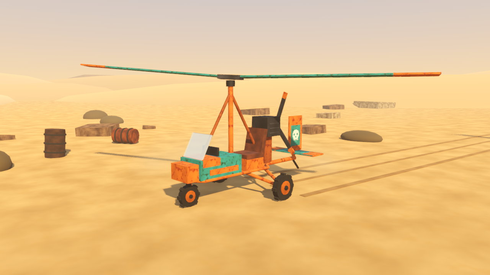
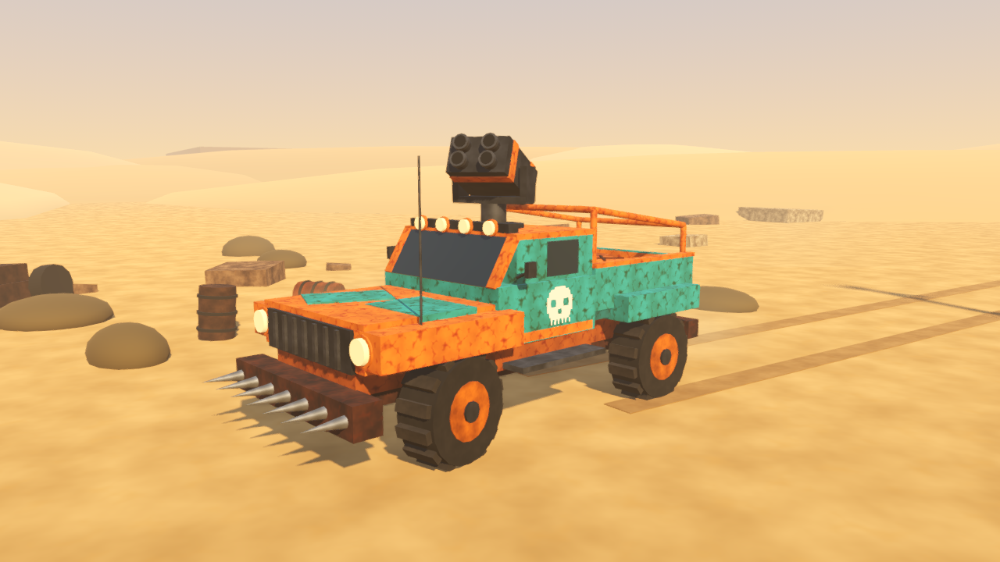
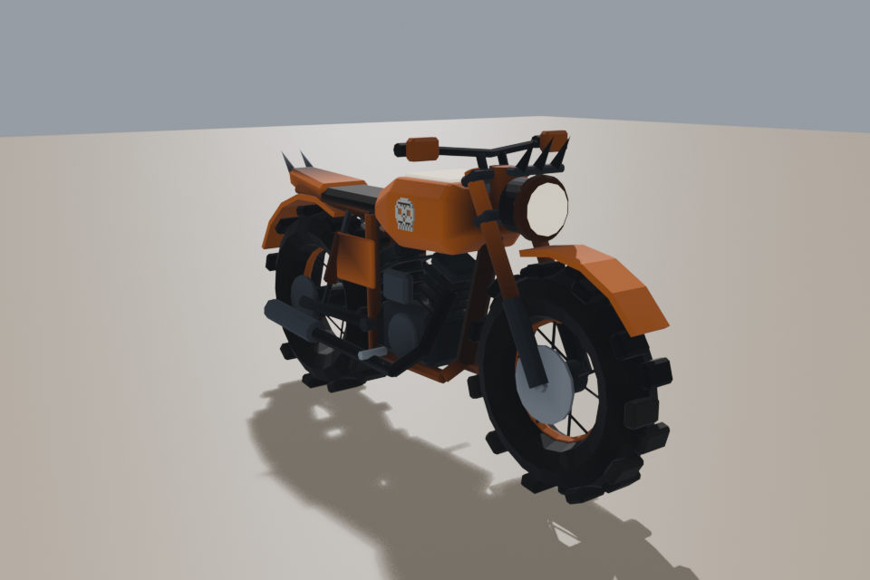
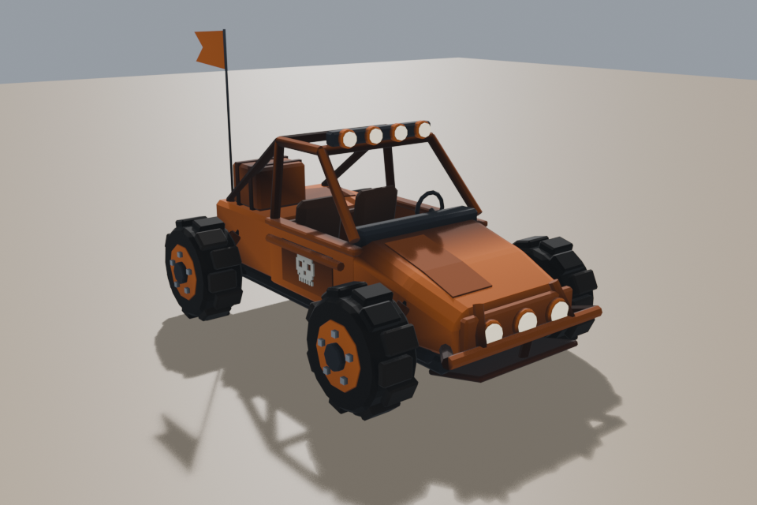
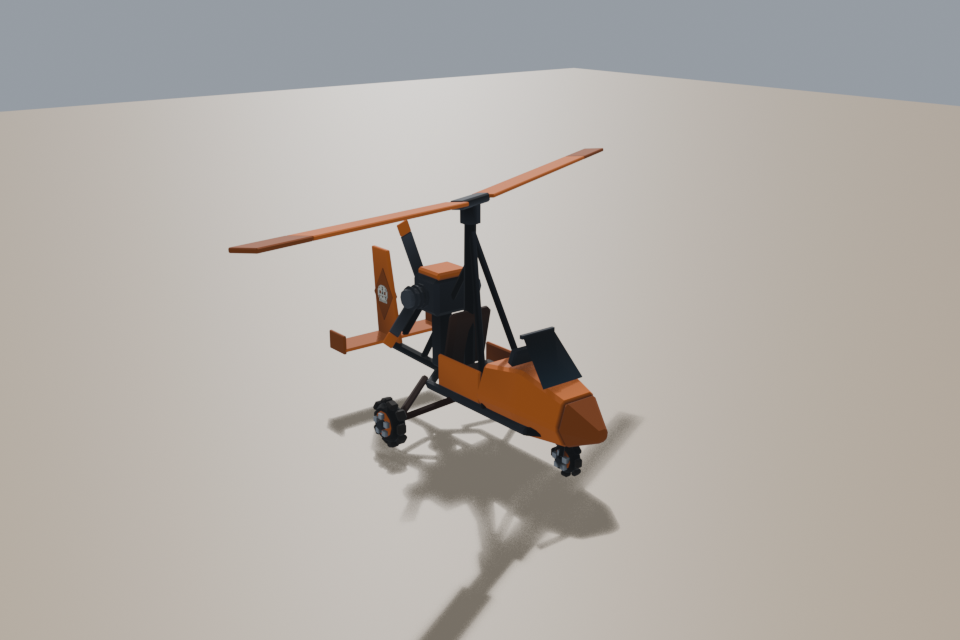
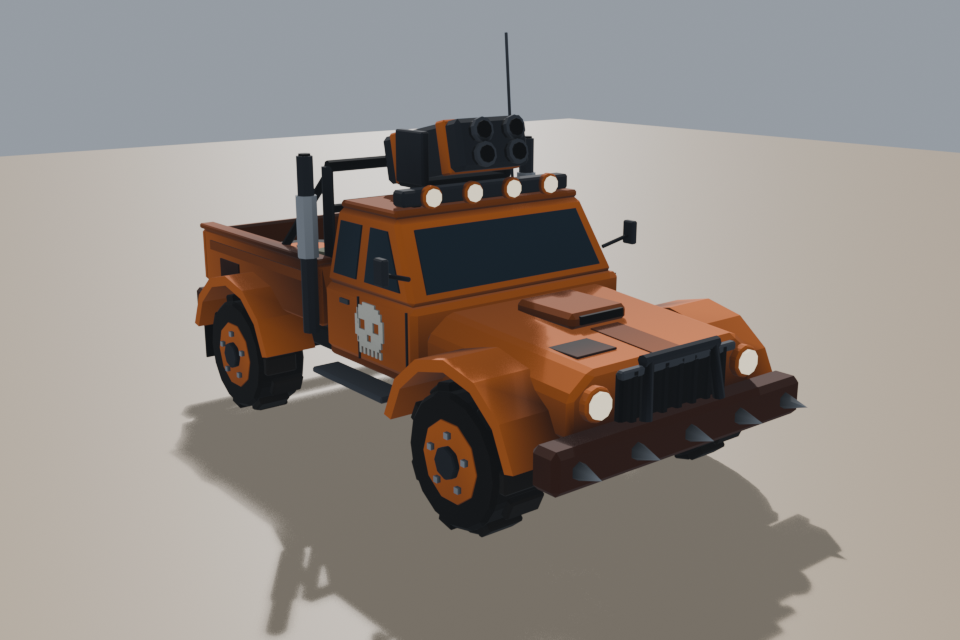

# Wasteland Fire

A two-player split-screen 3D vehicle game for one keyboard and one couch, in
the spirit of Return Fire (1995). Drive wasteland Motorbikes, Buggies, Trucks
and Gyrocopters, steal the other Player's Flag and haul it home on a Motorbike
before your Fuel runs dry and your Tokens run out.

Built in Godot 4.7.2 with GDScript. A hobby project, made for playing with
friends at home.



## How it plays

- The game opens on the map choice (story 038): Map 01 and Map 02 side by
  side, each with a picture of it from above. Either Player picks one with
  A / D or Left / Right (a pad's stick or D-pad) and starts with Space, Period
  or Enter (a pad's A), or clicks a card. R restarts the same Map; Esc (a
  pad's B) on the Round-over screen goes back to the map choice.
- A Flag can be taken whatever stands around it (story 039): no Turret locks
  it any more, and the Motorbike's Shots break the other Player's walls and
  Turrets like everyone else's.
- Two Players share one keyboard and one screen, split side by side. Each
  Player can also play with an Xbox controller (story 032): the first pad
  connected is Player 1's, the second Player 2's, and the keyboard keeps
  working beside it. The left stick drives (up forward, down reverse, left and
  right steer and move the Unit choice; the D-pad steers too), RT or A fires
  low and RB fires high (story 041), LT fires the secondary weapon (story
  042), A confirms the Unit (story 040), Y switch the camera, View Self-destruct, Menu restart the Round. A pad
  can be plugged in or out during a Round; the Player's view says so.
- Every Unit has a secondary weapon on E / Comma / LT (stories 042 and 044),
  each refilling in 15 s, with a bar on the HUD where the Tokens line was
  (story 045): the Truck lays a Mine
  ("Mine", unlimited), the Buggy boosts for 2 s at 1.6 times its top speed
  ("Boost"), the Gyrocopter drops a big smoke screen 10 m ahead of it for 3 s
  that hides it, and everything in and behind it, from both views and from the
  Turrets ("Smoke"), and a Motorbike carrying a Flag drops it ("Drop flag").
- Bushes are bigger (story 044): a Motorbike can hide in one.
- Fuel zones are the fuel bar's amber and ammunition zones the ammo bar's
  blue (story 045).
- The Flag is a real flag (story 043): a 3 m pole with a waving cloth in its
  Team colour, carried on the Motorbike like a banner, planted where it falls.
- Each Player spawns Units from the Garage at their Base, paying one Token of
  that type per spawn. The Map sets the Token stock.
- Four Units. The Motorbike is fast, weak and the only one that can carry a
  Flag. The Buggy beats the Truck, the Truck beats the Gyrocopter and the
  Gyrocopter beats the Buggy. Only the Gyrocopter crosses cliffs and water.
- The Gyrocopter flies high. Its model is drawn at one height, its lowest point
  2.5 m over the ground, from the tick it appears in its Garage until it is
  destroyed or put away: it never rises, settles, takes off or lands. It flies
  over every low piece (every Wall Panel and Flag Wall, the wrecks, the
  containers, the cliffs and the water) and over every Unit, and only the Tall
  pieces stop it: the corner towers, the water towers' legs, the depot's Fuel
  tanks and the Turrets, besides the sea's edge. The tank on top of a water
  tower is above it, so it can fly between the legs under it. Shots still fly
  at one height, 0.5 m, so it is hit and hits there, 2 m under its model, and a
  wall or a piece of cover between it and its target stops the Shot. Right over
  a Truck it is drawn with the Truck's antenna through its gear.
- The Gyrocopter's rotor turns while it is in play, 4 times a second, and each
  of its two blades, in the Team colour with a darker tip, trails a soft
  see-through smear about a quarter of a turn behind it, so the two blades can
  always be counted and the turn looks smooth rather than flickering. The
  pusher propeller behind it turns 2 times a second while it stands and faster
  as it speeds up, 5 times a second at its top speed forward or in reverse, with
  a smear of its own. Both are pictures only: a new Gyrocopter appears with them
  at rest, and they stand still under the Round-over screen with everything
  else.
- Ground vehicles leave tyre tracks: the Motorbike one line behind its two
  wheels, the Buggy and the Truck two, each as wide as its tyre (0.20 and 0.25
  m, 0.30 m, 0.36 m). A track is darker, packed ground with a shallow rut that
  catches the low sun, on the sand, the canyon road and the salt flat, and never
  in the water, the fords or the Garages. A track holds its full strength for 20
  seconds and then fades away over the next 40, counted in the Round's time (the
  Round-over screen stops the fading), and every Round, and R, starts on clean
  ground. The Gyrocopter flies and leaves none. A track ends a little behind the
  tyre as it is drawn (up to one physics tick of travel: a third of a metre at a
  Buggy's top speed), never ahead of it, and it is whole at any frame rate. A
  picture only: nothing in a Round reads it.
- A Gyrocopter that flies straight into a Tall piece at speed crashes: at 4 m/s
  or more into the piece's face (a quarter of its top speed, which full
  throttle reaches in about half a metre) it is destroyed on the tick it meets
  the piece and explodes, which costs a Gyrocopter Token like any destruction.
  Backing into one at its full reverse speed (6 m/s) crashes it too. Eased in
  with taps, grazing a face at under about 14 degrees, turning on the spot or
  pinned with the throttle held against one, it only stops or slides. The
  sea's edge only stops it, the piece takes no damage, and a ground Unit
  never crashes.
- Every Unit burns Fuel while moving, and a little while it stands: a full
  tank lasts a Motorbike about 100 seconds of driving, a Gyrocopter about 40
  (story 036 halved the burn). Your Fuel shows as the amber
  bar with a jerrycan beside your hit points. Fuel is
  refilled only in the two amber Fuel zones on the ground at the sides of the
  depot in the middle of the Map, one facing each Base, each marked with a
  dashed edge: a Unit that has stopped in one is topped up, from empty to full
  in about 4 seconds, and both Players can fill at once. A Unit rolling
  through, or setting off, gets nothing, and a Gyrocopter hovering over a zone
  counts as stopped. The zones give Fuel only (no hit points, ammo or Mines),
  and the Fuel Cans are gone from the Map.
- Every Unit's gun holds a load of ammo, counted in Shots: a Motorbike 100, a
  Buggy 50, a Truck 25 and a Gyrocopter 40, which is 20 seconds of continuous
  fire at its own rate. Each Shot spends one. Your count shows as the blue
  bar with three cartridges right of the Fuel bar, and the last Shot says "Out of ammo" for a second and a half,
  as does every new press of the fire key after it. An empty gun fires
  nothing, but the Unit still drives, carries the Flag and lays Mines. Ammo
  comes back with a new Unit and in the ammunition buildings' zones (next
  bullet). The Turrets never run out.
- Ammo is refilled in the two ammunition buildings, one low building of crates
  on each half of the Map, on the salt flat beside where the Fuel Cans used to
  be (about 64 m either side of the middle). Each has a pale yellow zone on the
  ground on the side that faces the centre, edged with a dashed line. A Unit
  that has stopped in the zone is rearmed, from an empty gun to a full load in
  about 4 seconds, a whole Shot at a time with your Ammo line counting up; both
  Players can rearm at once, either Player can use either building, and a
  Gyrocopter hovering over a zone counts as stopped. A Unit rolling through, or
  setting off, gets nothing. A zone gives ammo only (no Fuel, hit points or
  Mines; a Truck's Mines come back only with a new Truck). A building is about
  1.8 m tall: ground Units and every Shot stop at it, as at cover, nothing
  destroys it, and the Gyrocopter flies over it. No Mine can be laid in or
  within about 3 m of any supply zone, a Fuel zone included: the press lays
  nothing, keeps your count and the notice line says
  "No Mines at a supply building" for a second and a half.
- Each Base keeps its Flag in a box of four Flag Walls under its water tower.
  A Buggy, a Truck or a Gyrocopter breaks one with its Shots (the Motorbike's
  Shots do nothing to it); a hit wall looks damaged, darker and cracked with
  chunks at its foot, and worse below about a third of its strength. Once one
  falls, and both Turrets of that Base are down, a Motorbike can drive in and
  take the Flag. The Gyrocopter flies over the walls but cannot carry. A broken
  Flag Wall stays down until the Round is played again.
- Each Base's own walls are Wall Panels of the same kind: 30 panels about 2 m
  tall (8 along the back, 8 along each side and 3 in each Gate wall) between the
  four corner towers, which stay 6 m tall and solid. A standing panel stops
  every ground Unit and every Shot and has 40 hit points like a Flag Wall: a
  Buggy, a Truck or a Gyrocopter breaks one (the Motorbike's Shots do nothing),
  a Player's own Shots and own Turrets' Shots never hurt that Player's own
  walls, and a hit panel looks damaged as a Flag Wall does. A fallen panel is
  low rubble and a gap, a breach that every ground Unit drives through (a Truck
  just fits the one a Gate-wall panel leaves); it is not a Gate: the yard, the
  Base zone, the Swap at home, a delivery and the Turrets' hold on the Flag
  work as before, and a Turret sees through it. The Gyrocopter flies over every
  panel. A fallen panel stays down until the Round is played again. Mines are
  still refused in or near a Base, but a Truck can lay one in the outer part of
  a breach in a side or back wall.
- Each Garage's three walls are Wall Panels of its Base too: 10 panels about 2 m
  tall and 1 m thick (4 along the back, 3 along each side), dark like the Base
  walls, with the same 40 hit points and looks. Only the other Player breaks
  them. A side panel broken beside a spawn spot lets the other Player's Shots
  hit a Unit standing on it and lets ground Units drive in and out; a broken
  back panel opens only the 0.7 m gap before the Base's back wall. The
  Gyrocopter flies over them. The two walls in the field are Wall Panels as
  well, four 3 m panels each and 2.5 m thick, but they belong to nobody: both
  Players' Shots break them (never a Motorbike's), a Truck can lay a Mine in a
  gap, and R stands them again. Only the wrecks and the containers are Cover
  now, and nothing destroys them.
- Two Turrets stand outside each Gate, one on each side. They shoot only at the
  other Player's Unit, aim ahead of it where it will be, and need a clear line
  of sight; every Unit's Shots hurt them (20 Motorbike Shots break one) and
  they cannot be built or taken. While either Turret of a Base stands the other
  Player cannot take that Base's Flag: their view says "Destroy the turrets
  first" while their Motorbike touches it. A broken Turret stays down until the
  Round is played again. A Turret stands about 3 m tall, and a hit one shows it
  as a wall does: its drum darker and cracked with chunks at its foot and its
  head a darker steel, worse below about a third of its strength, its band
  keeping its Player's colour and its head still turning and firing; in the
  chase view a Unit that drives out right behind one is hidden by it for a few
  metres.
- The Truck lays Mines, five a Truck: one press of its lay key drops one just
  behind its tail. A new Mine blinks in its owner's Team colour for 3 seconds
  and is harmless; then it shines steadily and is live, and destroys any ground
  Unit that drives onto it at once, a full Truck and its owner's own Unit
  included, in a short flash. The Gyrocopter flies over Mines and Shots never
  set them off. A Mine cannot be laid in or near a Base (the yard, and about
  10 m in front of each Gate), in or within about 3 m of a supply zone (the
  Fuel zones and the ammunition zones), or where it would not lie on open
  ground (a wall, the cover, a tank, a cliff, water): the Player's view says
  why for a moment.
  A Mine stays when its Truck is destroyed, and a Round played again starts
  with none.
- A destroyed Unit explodes: a flash, a fireball, a few dark chunks and some
  grey smoke for about 2 seconds, where the Unit was seen (a Gyrocopter's in the
  air), in both views, bigger for a Truck than for a Motorbike. Every
  destruction that counts plays one (the other Player's Shots, a Turret, a Mine,
  a Self-destruct, a Gyrocopter's empty tank); a Swap inside your own Base and
  the start of a Round never do. It is only a picture: it hurts nothing, pushes
  nothing, stops no Shot and leaves no wreck, so a Flag dropped where a Carrier
  died can still be picked up in it, and a Mine's kill shows the Mine's own
  flash with it. The explosion that ends a Round keeps playing behind the
  Round-over screen, and R clears any that is left.
- A Unit that is nearly destroyed shows it. At or below a fifth of its hit
  points (8 of a Motorbike's 40, 20 of a Buggy's 100, 44 of a Truck's 220, 14 of
  a Gyrocopter's 70, the edge included) it is badly damaged: thin dark grey
  smoke rises from the top of its body, a column while it stands and a short
  trail behind it while it moves, in both views, and its top speed drops to half,
  forward and in reverse, reached at the Unit's own acceleration in about 0.6 s.
  Turning, the weapon, the Fuel burn per second and the HUD stay as they were,
  and in a ford the lower of the two limits holds. It lasts until the Unit is
  destroyed or put away (a Swap, R): the Unit that comes next is whole. A Mine, a
  Self-destruct or an empty Gyrocopter tank destroys at once and never passes
  through it, and a Turret can bring a Unit into it as a Shot can.
- Win by delivering the opponent's Flag to your own Base. Lose by losing your
  last Motorbike, because without one you can never carry a Flag.

The rules of record are in `design/rules.md`, the one-page brief in
`design/game-brief.md` and the vocabulary in `CONTEXT.md`.

## Status

| Story | What | State |
|---|---|---|
| 001 | Driving toy: one Motorbike, chase camera, arcade kinematic driving | Done |
| 002 | Split screen for two, one fixed keyboard layout per Player | Done |
| 003 | Bases, destruction and respawn, self-destruct | Done |
| 004 | The Flag and the win, per-Player HUD, round-over screen | Done |
| 005 | Four Units and the counter triangle | Done |
| 006 | Fuel and Fuel Cans | Done |
| 007 | Map 01 with the Team colours | Done |
| 008 | Tokens, the Garage and the loss | Done |
| 009 | Playtest quick fixes: solid depot tanks, the Gyrocopter over the cover, turning on the spot, slower Fuel burn standing, the out-of-Fuel hint | Done |
| 010 | The camera from above, with a key back to the chase view | Done |
| 011 | The Unit swap at the own Base | Done |
| 012 | Flag Walls: a box of four breakable walls around each Flag, which look damaged as they take hits; new Units appear on the Garage's side spots | Done |
| 013 | Turrets: two per Base outside the Gate that shoot at the other Player's Unit; no Flag can be taken while one of its Base's Turrets stands | Done |
| 014 | The Truck's Mines: five per Truck, laid with E or Comma, live after 3 s, destroying any ground Unit that drives onto them; never laid in or near a Base | Done |
| 015 | Turrets show their damage: a darker, cracked drum with chunks at its foot and a darker head below 80% of their hit points, worse below 35%, and they stand about 3 m tall | Done |
| 016 | A destroyed Unit explodes: a flash, a fireball, six dark chunks and grey smoke for about 2 s at every destruction, in both views; a Swap and the start of a Round never do | Done |
| 017 | Badly damaged Units smoke and slow down: at or below a fifth of its hit points a Unit smokes (thin dark grey, a column standing and a trail moving, in both views) and drives at half speed until it is destroyed or put away | Done |
| 018 | The Base walls become Wall Panels: thirty 2 m panels a Base, dark like the Flag Walls, with 40 hit points and the Flag Walls' damaged looks; a fallen one is a breach (a gap with rubble, no Gate) until R brings it back; the corner towers stay | Done |
| 019 | The Garage walls and the scrap walls become Wall Panels: ten 2 m panels a Garage (4 along the back, 3 along each side), owned by that Base's Player, and two walls of four 3 m panels in the field that belong to nobody; the same 40 hit points and damaged looks; Cover is now only the wrecks and the containers; a Gyrocopter on a Garage spot is drawn risen to 2.25 m until story 020 | Done |
| 020 | Two Heights: the Gyrocopter flies at one height, its lowest point 2.5 m up from the tick it appears in its Garage, over every wall, piece of cover, cliff, channel and ground Unit; only the Tall pieces (the corner towers, the water towers' legs, the depot's Fuel tanks and the Turrets) stop it; every Shot still flies at 0.5 m, so a Shot from a Gyrocopter is drawn about 2 m under its wheels | Done |
| 021 | A Gyrocopter that flies into a Tall piece crashes: flown straight into a corner tower, a water tower leg, a depot Fuel tank or a Turret at 4 m/s or more it is destroyed in that tick and explodes, and costs a Token like any other destruction; a graze, a slow nudge, a turn on the spot or the throttle held against a piece only stop it, the sea edge only stops it, and the piece takes no damage | Done |
| 022 | Ammo, and full supplies for every new Unit: every Unit's gun holds a load of ammo (a Motorbike 100 Shots, a Buggy 50, a Truck 25, a Gyrocopter 40: 20 s of continuous fire at the type's own rate), each Shot spends one, and an empty gun fires nothing while the Unit still drives, carries the Flag and lays Mines; your count shows as "Ammo n / max" under the HUD band and "Out of ammo" shows on the notice line for 1.5 s; every new Unit, at the first spawn, every respawn and every Swap, starts with a full tank and a full load of ammo, so a Self-destruct trades a Token for full supplies and a Swap at your own Base is a free resupply; the Turrets never run out and the Truck's Mines stay a count of their own | Done |
| 023 | The Fuel building replaces the Fuel Cans: the depot at the centre of Map 01 is the one Fuel building, with an amber Fuel zone (6 x 6 m, edged with dark dashes, drawn on the ground in both views of both Players) on each of its two sides that face a Base; a Unit that has stopped in a zone (its real speed about zero: held against a tank with the throttle on still counts, a Gyrocopter hovering still counts, rolling through at any speed does not) is refuelled gradually, from empty to full in about 4 s while it stands there, both Players at once if need be, with Fuel only (no hit points, ammo or Mines), and a zone never runs dry; the nine Fuel Cans are gone from the Map, so a ground Unit that runs dry anywhere else stays stranded until it Self-destructs (in its own Base, swaps) | Done |
| 024 | The ammunition buildings, and no Mines at the supply zones: each half of Map 01's salt flat has an ammunition building about 64 m from the middle (a low store of crates on a plinth, 1.8 m tall, with pale yellow stripes: the Gyrocopter flies over it, ground Units and every Shot stop at it, and nothing destroys it) with a pale yellow zone (6 x 6 m, edged with dark dashes, drawn on the ground in both views of both Players) on its side that faces the centre; a Unit that has stopped in one (the same test as the Fuel zones: held against the building with the throttle on still counts, a Gyrocopter hovering still counts, rolling through at any speed does not) has its gun filled gradually, from empty to a full load in about 4 s while it stands there, both Players at once if need be, with ammo only (no Fuel, Mines or hit points), and a zone never runs dry; no Mine can be laid in or within 3 m of any of the four supply zones, the Fuel zones included: the press lays nothing, keeps the count, and shows "No Mines at a supply building" for a second and a half on that Player's line | Done |
| 025 | The Gyrocopter's rotor and propeller turn: while a Gyrocopter is in play its main rotor turns 4 times a second whatever its speed (24 degrees a physics tick, drawn between ticks on a faster display), two blades in the Team colour with darker tips, each trailing a soft see-through smear about a quarter of a turn behind it (90 degrees, strongest at the blade and fading to nothing, in the Team colour, casting no shadow while the blades' own shadows turn with them), so the two blades can always be counted and it is never a solid disc; the pusher propeller behind it turns 2 times a second standing, 3.5 at half its top speed and 5 at its top speed forward or in reverse, with a smear of its own (steel grey with Team-coloured tips); a new Gyrocopter appears with both parts at rest, a destroyed or put-away one draws nothing, the Round-over screen stops them with everything else, and a badly damaged Gyrocopter's rotor keeps its rate; the propeller's lowest tip passes 12 mm into the thin mast brace in one position of its turn, where neither camera can see it (TD-018) | Done |
| 026 | Ground Units leave tyre tracks: the Motorbike one line behind its two wheels, the Buggy and the Truck two, each as wide as its tyre (0.20 and 0.25 m, 0.30 m, 0.36 m), and the Gyrocopter none; a track is darker, packed ground with a shallow rut that catches the low sun, on the sand, the canyon road and the salt flat only (not in the water, the fords, on the Base pads, in the Garages or on a side face), drawn by the ground's own shader from one track map over Map 01's island (4096 x 1284 half-float pixels, 7.18 cm a pixel, cleared when a Round starts and updated only on a frame that has new strokes, so what has been driven costs nothing); a track holds its full strength for 20 s and fades out over the next 40, counted in the Round's time (the Round-over screen stops it), two tracks that cross are no darker than one, R and every new Round start on clean ground, and a track ends up to one physics tick of travel (0.36 m at a Buggy's top speed) behind the tyre as drawn, never ahead of it; every value is data (`tyre_track_settings.tres` and the three ground types' tyres) | Done |

Map 01 and the four Units have their low-poly look, lit by a low warm sun
under a desert sky with ambient occlusion and anti-aliasing. The ground is a
shader over noise textures generated in code: sand with patches of gravel, the
salt flat's cracked crust, the canyon road's packed dirt. The rocks, the
wrecks and containers, the Bases' steel trim, the fuel tanks and
the Turrets' detail are models built in Blender by the scripts in
`tools/blender/`, and so are the Units, from the concept sheet (since
2026-10-10; the concept kit under `assets/art/` they replaced stays as a
fallback). Every collider stays a Godot primitive. The older evidence scenarios still run on the
greybox field.

## Controls

| | Player 1 | Player 2 |
|---|---|---|
| Throttle / reverse | W / S | Up / Down |
| Steer | A / D | Left / Right |
| Fire low (ground Units, Turrets) | Space | Period |
| Fire high (the Gyrocopter, Turrets; over walls and cover) | Left Shift | Right Shift |
| Choose a Unit (previous / next) | A / D | Left / Right |
| Confirm the Unit | Space | Period |
| Self-destruct | Tab | Enter |
| Lay a Mine (Truck) | E | Comma |
| Boost (Buggy), smoke screen (Gyrocopter), drop the Flag (Motorbike): the same secondary key | E | Comma |
| Switch the camera view | Q | Slash |

Each Player chooses a Unit type at the start of a Round and after every
destruction, with the choice panel at the bottom of their own view. R restarts
from the round-over screen and stands every broken wall panel again.

A Round starts in the view from above: the camera stands high over your Unit,
tilted a little forward so you see more ground ahead than behind, and turns
with the Unit. The camera key switches your own view, at any time, between that
and the chase camera from behind; the other Player's view does not change, and
your choice stays through a restart. The tops of the water towers are not drawn
in the view from above, so the Flag on its seat and the Unit that takes it
stay in sight.

Each Player has a stock of Tokens for every Unit type; Map 01 gives both of
them Motorbike 5, Buggy 3, Truck 2 and Gyrocopter 2. A destroyed Unit costs one
Token of its type, taken when it is destroyed: enemy fire, a Self-destruct, a
Gyrocopter's empty-tank crash and its crash into a Tall piece all count. The
choice panel shows how many Tokens each type has left and dims a type with
none, which the cursor skips (the HUD's Motorbike Tokens line is gone since
story 045: the choice panel's counts are the place to look). A Round ends when a Player delivers the other's
Flag, or when a Player's last Motorbike Token is gone: that Player loses. If
both lose their last one on the same tick, nobody wins and the screen says so.
R starts the Round again with full stocks.

Keys 1 and 2 used to damage each Player's own Unit for testing; they are off
now that weapons exist, and `debug_damage` in
`src/gameplay/match/data/match_rules.tres` brings them back.

Every new Unit, at the first spawn, after every destruction and after every
Swap, starts with a full tank and a full load of ammo, so a Self-destruct trades
a Token for full supplies and a Swap at home is a free resupply. The amber Fuel
gauge beside the hit points empties while the Unit moves and holds while it
stands still. Stop in one of the two amber Fuel zones beside the depot to refill
(about 4 seconds from empty), and in a pale yellow ammunition zone to rearm
(about 4 seconds from empty). A ground Unit with no Fuel stops but can still
turn and fire, and a Gyrocopter with no Fuel crashes. Self-destruct still works
with an empty tank, and at home it swaps the Unit.

Map 02 (story 038, from Martin's schematic of 2026-10-16) is a canyon about
105 by 250 metres inside its walls, played north against south: Orange at the
top, Teal at the bottom, each Base Map 01's compound turned with its Gate to the
west and its Garage east of its Flag, and eight Turrets: two at the Gate,
two facing the field and two at the back. A wall of Wall Panels crosses each half
with a gap between two Turrets of that half's Team (they fire at the other
Player and take no damage from their own). East of the field a rock ridge that only the
Gyrocopter crosses shuts off a passage with slowing water at both ends; a
breakable wall in the ridge's gap opens a third way in. One shared Fuel
building stands on the west side and each half has an ammunition building.
The left corridor holds Bushes (they hide a ground Unit from a Turret, stop no
Shot, and a Buggy or a Truck flattens them until the restart; the Motorbike
passes and the Gyrocopter flies over), car wrecks and small buildings, which
stop Units and Shots and break under anyone's fire, the Motorbike's too. The
Tokens are Map 01's.

Map 01 is an island about 300 by 100 metres. Orange is Player 1 at the west Base
and Teal is Player 2 at the east Base; each Base is a compound walled by 2 m
Wall Panels between four 6 m corner towers, with one gate facing the centre, a
Garage walled by Wall Panels (roofless) and a water tower over the Flag. A
canyon road runs along the north and a cracked salt flat fills the middle, with
the Fuel depot at its centre (three tanks and a Fuel zone each side of them),
an ammunition building with its zone on each half, wrecks and containers for
cover and a short wall of Wall Panels each side of the middle. Two shallow
fords across the
flat slow ground Units to half speed. A rocky ridge in the south, cut by two
channels, is crossed only by the Gyrocopter, and the sea around the island stops
every Unit.

## Running it

1. Install Godot 4.7.2. The project is pinned to that version; see
   `docs/engine-reference/godot/VERSION.md`.
2. Open the project folder in the editor and press Play, or from the repo
   root:

```
godot --path .
```

The game opens on the map choice; the chosen Map then plays in the split
screen.

Tests use gdUnit4 and run headless. The same suite runs in GitHub Actions on
every push:

```
godot --headless -s -d --remote-debug tcp://127.0.0.1:0 res://addons/gdUnit4/bin/GdUnitCmdTool.gd -a res://tests --ignoreHeadlessMode
```

## Repository layout

- `src/gameplay/` is the game: units, match rules, split screen, maps, chase
  camera and the Flag. `src/ui/hud/` is the HUD.
- `tests/` holds the gdUnit4 tests.
- `design/` holds the brief, the rules of record and the author's Slovak
  source with its English translation.
- `production/` holds the epic, the stories and the retained QA evidence, one
  folder of screenshots per story.
- `assets/art/` holds the vehicle concept models, a shared palette and a
  showcase scene that renders them, and the Units' Blender models (`.glb`)
  with their preview renders.
- `tools/blender/` holds the Python scripts that build the Units' models in
  Blender; `tools/evidence/` the evidence harness.
- `docs/` holds engine reference notes pinned to Godot 4.7.2 and the
  framework's workflow guide.
- `.claude/` holds the agents, skills and hooks of the development framework
  described below.

## Concept art

Four vehicles in one kit, kitbashed from Godot's built-in meshes with
procedural rust and paint-chip textures, rendered by the engine itself.

| Motorbike | Buggy |
|---|---|
|  |  |

| Gyrocopter | Truck |
|---|---|
|  |  |

The models in the game, built in Blender from the same sheet in one Team colour
(here Player 1's orange), by the scripts in `tools/blender/`:

| Motorbike | Buggy |
|---|---|
|  |  |

| Gyrocopter | Truck |
|---|---|
|  |  |

## How it is made

The project is developed with [Claude Code](https://claude.com/claude-code)
inside [Claude Code Game Studios](https://github.com/Donchitos/Claude-Code-Game-Studios)
by Donchitos, a studio-shaped set of agents, skills and quality gates for
Claude Code. The framework turns the work into stories with acceptance
criteria, reviews and retained evidence. The design, the decisions and the
playtesting are the author's.

## Credits and licence

- Game design, code and art: copyright 2026 Tomas Kunzo. A licence for the
  game's own content has not been chosen yet.
- Development framework: Claude Code Game Studios by Donchitos, MIT licence,
  see `LICENSE`.
- Test framework: gdUnit4 by Mike Schulze, MIT licence, see
  `addons/gdUnit4/LICENSE`.
- Inspiration: Return Fire (1995). No code or assets from it are used.
